<picture>
  <source media="(prefers-color-scheme: dark)" srcset="assets/dark/hero.svg">
  
</picture>

<picture>
  <source media="(prefers-color-scheme: dark)" srcset="assets/dark/intro.svg">
  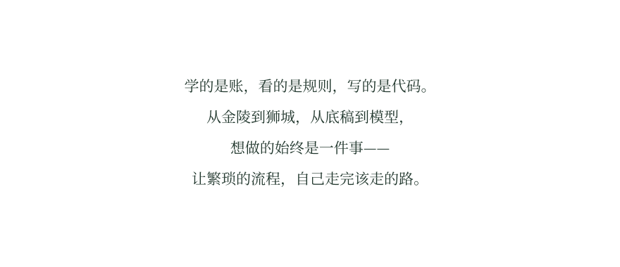
</picture>

<picture>
  <source media="(prefers-color-scheme: dark)" srcset="assets/dark/h01.svg">
  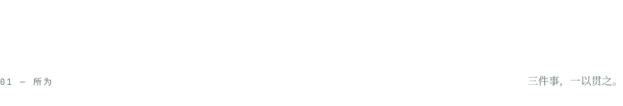
</picture>

<picture>
  <source media="(prefers-color-scheme: dark)" srcset="assets/dark/three.svg">
  
</picture>

<picture>
  <source media="(prefers-color-scheme: dark)" srcset="assets/dark/h02.svg">
  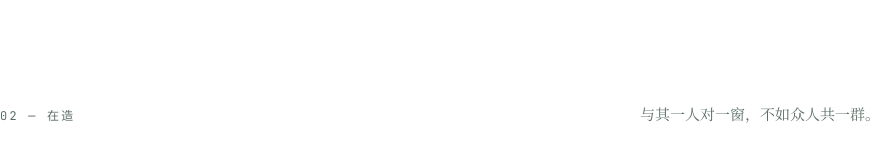
</picture>

<a href="https://github.com/1518213712-eng/crewmind">
<picture>
  <source media="(prefers-color-scheme: dark)" srcset="assets/dark/crewmind.svg">
  
</picture>
</a>

<a href="https://github.com/1518213712-eng/crewmind">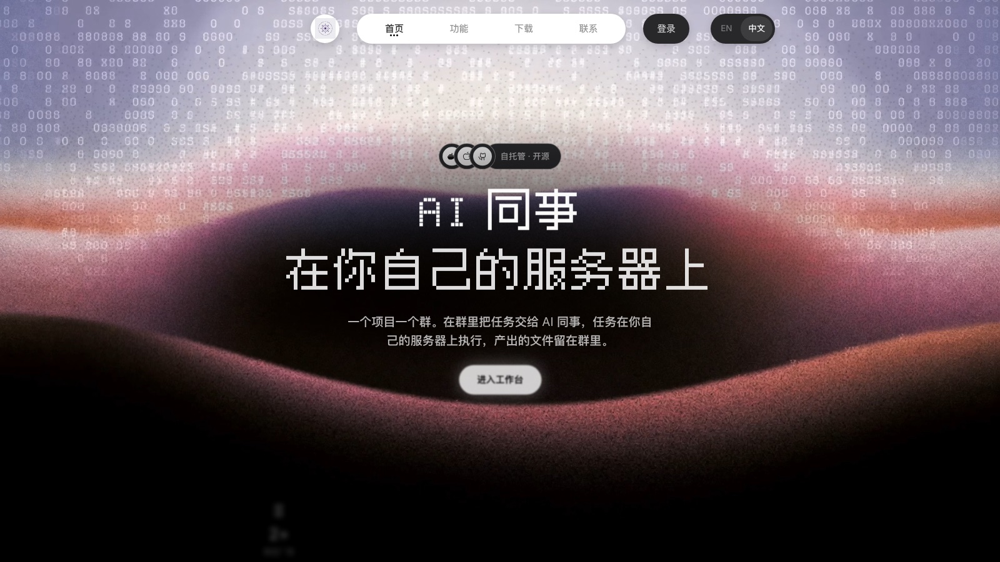</a>

<a href="https://crew-mind.xyz">
<picture>
  <source media="(prefers-color-scheme: dark)" srcset="assets/dark/crewmind-foot.svg">
  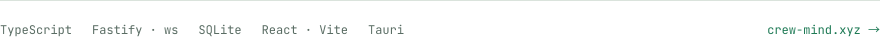
</picture>
</a>

<picture>
  <source media="(prefers-color-scheme: dark)" srcset="assets/dark/h03.svg">
  
</picture>

<a href="https://github.com/1518213712-eng/mingwen-law-workbench">
<picture>
  <source media="(prefers-color-scheme: dark)" srcset="assets/dark/work1.svg">
  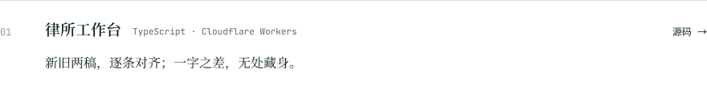
</picture>
</a>

<a href="https://1518213712-eng.github.io/calvin-auto-compliance-briefing/">
<picture>
  <source media="(prefers-color-scheme: dark)" srcset="assets/dark/work2.svg">
  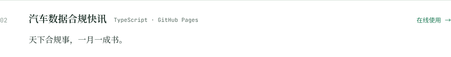
</picture>
</a>

<a href="https://github.com/1518213712-eng/legal-ai-presentation">
<picture>
  <source media="(prefers-color-scheme: dark)" srcset="assets/dark/work3.svg">
  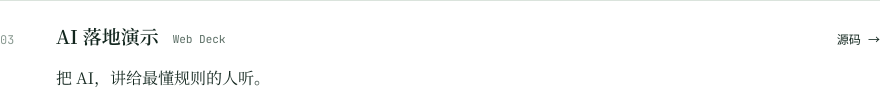
</picture>
</a>

<a href="https://github.com/1518213712-eng/empty-house-letter">
<picture>
  <source media="(prefers-color-scheme: dark)" srcset="assets/dark/work4.svg">
  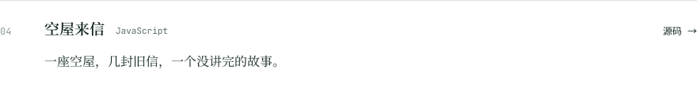
</picture>
</a>

<a href="https://github.com/1518213712-eng/Admission-show">
<picture>
  <source media="(prefers-color-scheme: dark)" srcset="assets/dark/work5.svg">
  
</picture>
</a>

<picture>
  <source media="(prefers-color-scheme: dark)" srcset="assets/dark/h04.svg">
  
</picture>

<picture>
  <source media="(prefers-color-scheme: dark)" srcset="assets/dark/path.svg">
  
</picture>

<picture>
  <source media="(prefers-color-scheme: dark)" srcset="assets/dark/exp1.svg">
  
</picture>

<picture>
  <source media="(prefers-color-scheme: dark)" srcset="assets/dark/exp2.svg">
  
</picture>

<picture>
  <source media="(prefers-color-scheme: dark)" srcset="assets/dark/exp3.svg">
  
</picture>

<picture>
  <source media="(prefers-color-scheme: dark)" srcset="assets/dark/exp4.svg">
  
</picture>

<picture>
  <source media="(prefers-color-scheme: dark)" srcset="assets/dark/exp5.svg">
  
</picture>

<picture>
  <source media="(prefers-color-scheme: dark)" srcset="assets/dark/exp6.svg">
  
</picture>

<picture>
  <source media="(prefers-color-scheme: dark)" srcset="assets/dark/h05.svg">
  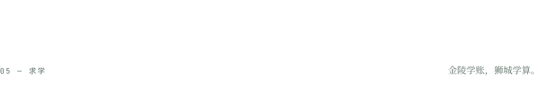
</picture>

<picture>
  <source media="(prefers-color-scheme: dark)" srcset="assets/dark/edu.svg">
  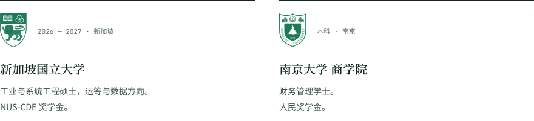
</picture>

<picture>
  <source media="(prefers-color-scheme: dark)" srcset="assets/dark/h06.svg">
  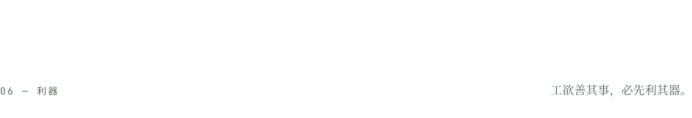
</picture>

<picture>
  <source media="(prefers-color-scheme: dark)" srcset="assets/dark/tools.svg">
  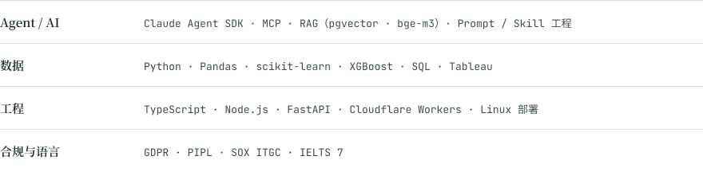
</picture>

<picture>
  <source media="(prefers-color-scheme: dark)" srcset="assets/dark/footer.svg">
  
</picture>
